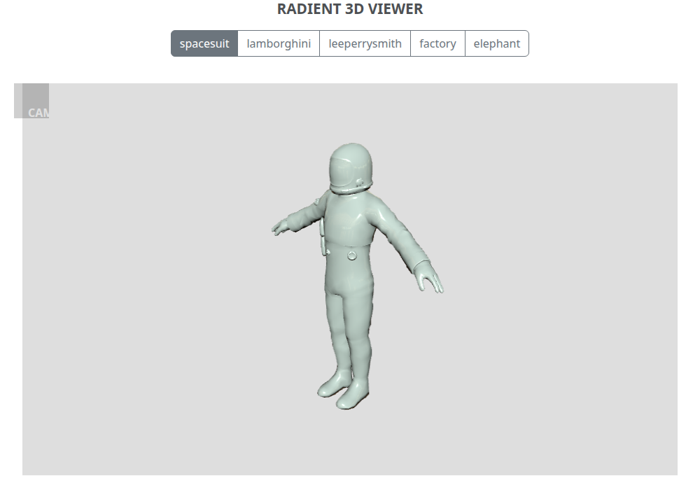

# radient-3d-viewer

A small three.js viewer for 3D models in the browser, served by a [Tornado](https://www.tornadoweb.org/) app.
Five sample models ship with the repo; the camera, light, model position and colour are adjustable.



## Contents
[Requirements](#requirements) · [Setup & run](#setup--run) · [Configuration](#configuration) · [Test](#test) ·
[Docker](#docker) · [Deploy (production)](#deploy-production-behind-a-tls-proxy) ·
[Models & the conversion workflow](#models-and-the-conversion-workflow) · [Frontend dependencies](#frontend-dependencies) ·
[Architecture](#architecture) · [Known issues](#known-issues)

## Requirements
| For | Needs |
|---|---|
| Running the server | **Python 3.12+** (Tornado 6.6 itself requires >= 3.11; CI tests 3.12, 3.13 and 3.14) |
| Tests / frontend tooling | Node 22 (only for `npm run vendor` and the browser tests, not for running the app) |
| Docker | Docker with Compose v2 |

## Setup & run
```bash
python -m venv .venv && source .venv/bin/activate
pip install -r requirements.txt
python run.py 8888            # or: ./run-radient.sh 8888   (or set PORT)
```
Open <http://localhost:8888> (it redirects to `/main`).

* Use the buttons on top to switch between the five models.
* Hover over the **CAM** box (top left) for the controls: camera distance / height / angle, light position,
  model position buttons and the colour picker.

## Configuration
Environment variables read by the app. `run.py` does **not** load `.env` files; export the variables
(`set -a; source .env; set +a`) or pass them in your process manager. `docker compose` reads `.env` for the
variables it forwards (see [Docker](#docker)). See `.env.example`.

| Variable | Default | Meaning |
|---|---|---|
| `PORT` | – | Port (or pass it as the first argument to `run.py`) |
| `DEBUG` | off | `1` enables Tornado debug + autoreload. **Never in production** |
| `HSTS_SECONDS` | off | Sends `Strict-Transport-Security: max-age=<n>`. See the warning below |
| `HSTS_INCLUDE_SUBDOMAINS` | off | Adds `includeSubDomains` (only has an effect when `HSTS_SECONDS` is set). `preload` is never sent |
| `SECURE_COOKIES` | off | Marks the XSRF cookie `Secure`. Set to `1` when the site is served over HTTPS |

The server sets a strict Content-Security-Policy (nonce for the one inline script), `X-Frame-Options: DENY`,
`nosniff`, `Referrer-Policy: no-referrer`, and enables XSRF protection. **`POST /api` is an empty stub that
nothing in this repo calls; external clients of it must send the `_xsrf` cookie value in the `X-XSRFToken`
header (or an `_xsrf` form field).** The app has no secrets. It does not enforce HTTPS itself (no redirect):
that is the proxy's job, see [Deploy](#deploy-production-behind-a-tls-proxy).

## Test
```bash
pip install -r requirements-dev.txt
pytest                                    # server, security headers/CSP, path traversal, XSRF, converter

npm ci
npx playwright install chromium           # once
npx playwright test                       # starts the server itself; renders all 5 models, drives the controls
```
The browser tests fail on any failed request or page error (including CSP violations). If `python` is not
the interpreter you want, run `PYTHON=.venv/bin/python npx playwright test`. CI (`.github/workflows/ci.yml`) runs:
pytest on Python 3.12/3.13/3.14, the browser flow, the same flow against the Docker container, a
reproducibility check for models and vendored files, and `pip-audit` + `npm audit`.

## Docker
```bash
docker compose up --build            # http://localhost:8888
HOST_PORT=9000 docker compose up     # publish on another host port
```
Multi-stage image: a Node stage minifies the browser JS, then `python:3.13-slim` runs the app as a **non-root**
user (uid 10001) with a healthcheck. The compose file runs it with a read-only root filesystem,
`cap_drop: ALL` and `no-new-privileges`. Static assets and models are gzip-compressed on the wire.
`PORT`, `HSTS_SECONDS`, `HSTS_INCLUDE_SUBDOMAINS` and `SECURE_COOKIES` are forwarded from your shell / `.env`;
`DEBUG` is deliberately not forwarded.

## Deploy (production, behind a TLS proxy)
Run the container (or `python run.py`) behind a reverse proxy / load balancer that terminates TLS
(nginx, Caddy, an AWS ALB, ...). Checklist:

1. **Do not set `DEBUG`.**
2. **The proxy must redirect HTTP to HTTPS.** (This app has no HTTPS-only switch; the Django sibling repo has
   `DJANGO_HTTPS_ONLY`, this one relies on the proxy.)
3. Set `SECURE_COOKIES=1` once the site is served over HTTPS.
4. **HSTS is opt-in and hard to undo.** Browsers remember it for `max-age`, and it cannot be revoked remotely.
   Leave it off unless the *whole* host is HTTPS only. If you enable it, start small:
   `HSTS_SECONDS=3600`, then raise it. `HSTS_INCLUDE_SUBDOMAINS=1` forces https on **every subdomain**, so do
   not set it if any subdomain is plain HTTP; deployments reached by bare IP (for example EC2) should leave HSTS off.
   `preload` is never sent.
5. Only the proxy should be reachable from the internet; publish the container port to it only.

```bash
# example: behind a TLS-terminating proxy, short HSTS, no subdomains
HSTS_SECONDS=3600 SECURE_COOKIES=1 docker compose up -d --build
```

## Models and the conversion workflow
The viewer loads **glTF binary (`.glb`)** files from `models/` (`/models/<name>.glb`). The original three.js
JSON models are kept unchanged in `models/legacy/` and are the source of truth; the GLBs are generated:

```bash
python tools/convert_legacy_models.py                      # all of models/legacy -> models/*.glb
python tools/convert_legacy_models.py in.js out.glb        # one file
```
The converter is standard-library only and follows three.js `JSONLoader` semantics (face bitmask, quads split
into triangles, vertices multiplied by `1/scale`). One glTF primitive is written per material; texture file
names are preserved in the material's `extras.mapDiffuse`. **Textures are not embedded:**
`Spacesuit_{Body,Glove,Helmet}_D.tga` were never committed to this repository (the viewer also ignores model
materials and shades everything with one material). If the originals are found, extend the converter to embed
them (glTF accepts PNG/JPEG only, so convert the TGAs first), re-run it and re-check the result in the
[Khronos glTF Validator](https://github.khronos.org/glTF-Validator/).

To add a model: put the legacy JSON file in `models/legacy/`, add its name to the buttons in
`templates/main.html`, run the converter, and add it to `tests/test_converter.py` / `tests/e2e/viewer.spec.mjs`.
CI regenerates all GLBs and fails if any committed file differs (`reproducible` job), and
`tests/test_converter.py` checks triangle counts and byte-for-byte reproducibility.

## Frontend dependencies
three.js 0.187.0 and the Bootstrap 5.3.8 CSS are **vendored** in `static/vendor/` (committed, so running the app
needs no Node and no CDN). To update, change the versions in `package.json`, then:
```bash
npm ci && npm run vendor      # copies exactly the browser files from node_modules into static/vendor
```
`npm run minify` is used by the Dockerfile only (it rewrites files in place; do not run it on a working tree
you intend to commit).

## Architecture
```
browser ── GET /main ──────────► Tornado (controllers/main.py)
   │                              ├─ /main        HTML page + CSP nonce (templates/main.html)
   │                              ├─ /static/...  app.js, vendored three.js, CSS, cubemap
   │                              ├─ /models/...  *.glb
   │                              └─ /api         empty stub (XSRF-protected POST)
   └─ static/app.js (ES module, import map)
        GLTFLoader → merge primitives → smooth normals → one MeshStandardMaterial + cubemap
        sliders / buttons / colour input drive the camera, light and mesh every frame
```
| Path | What |
|---|---|
| `run.py`, `controllers/` | entrypoint, handlers (`main.py`), security headers (`security.py`) |
| `templates/main.html`, `static/app.js` | the page and the viewer |
| `models/*.glb`, `models/legacy/*.js` | served models and their JSON originals |
| `tools/` | `convert_legacy_models.py`, `vendor.mjs`, `minify.mjs` |
| `tests/` | pytest suites and the Playwright spec |

## Known issues
* The spacesuit's original textures are missing (see above).
* Lighting is smoother than the old r75 renderer: physically based lights instead of the old non-physical ones.
* `HEAD /main` returns 405 (only `GET` is implemented); use `GET` for health probes.
